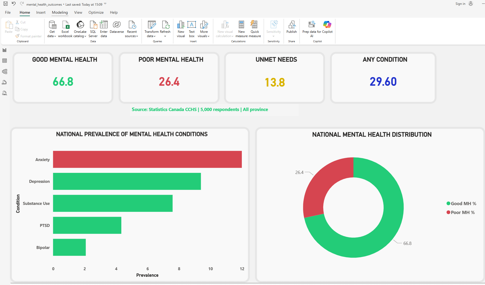
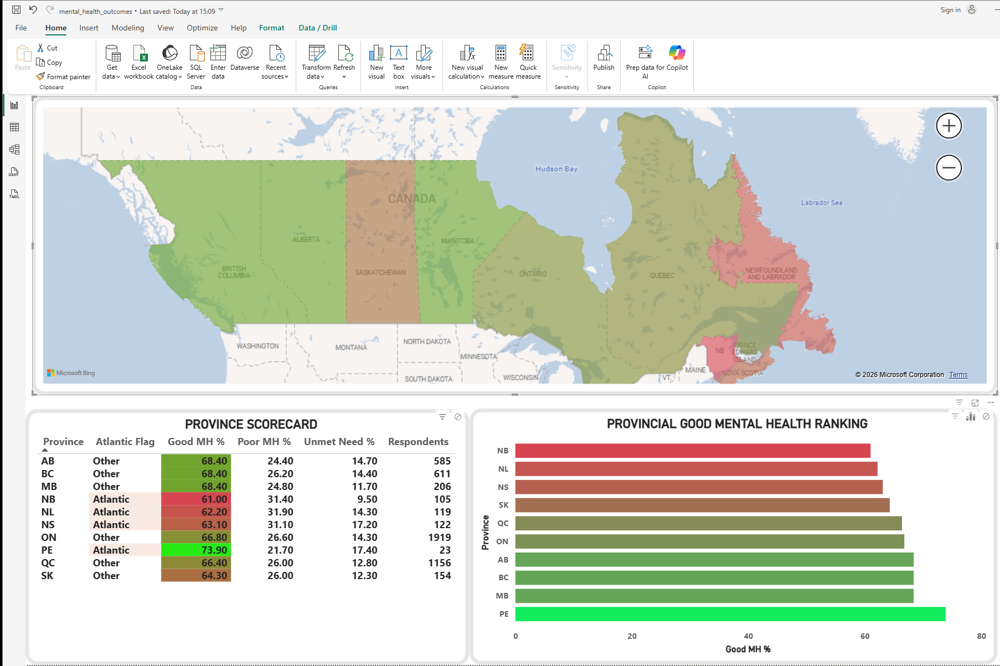
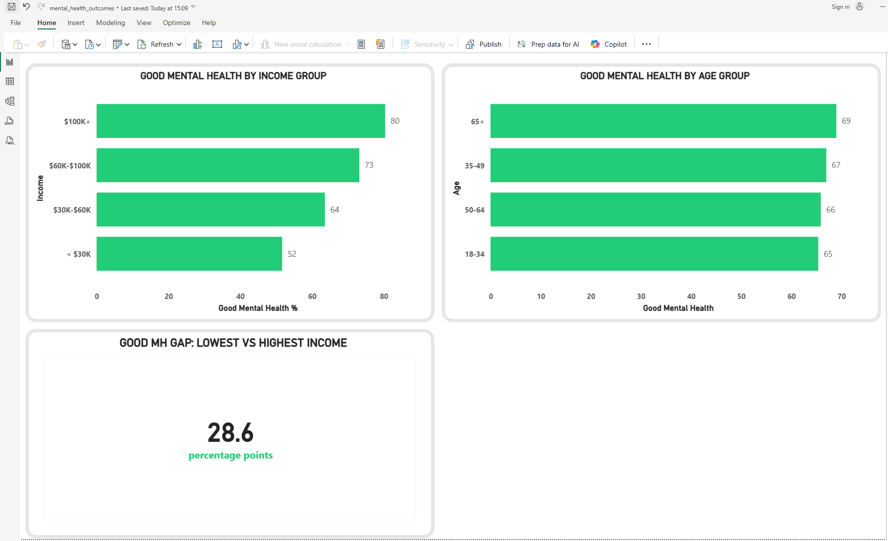
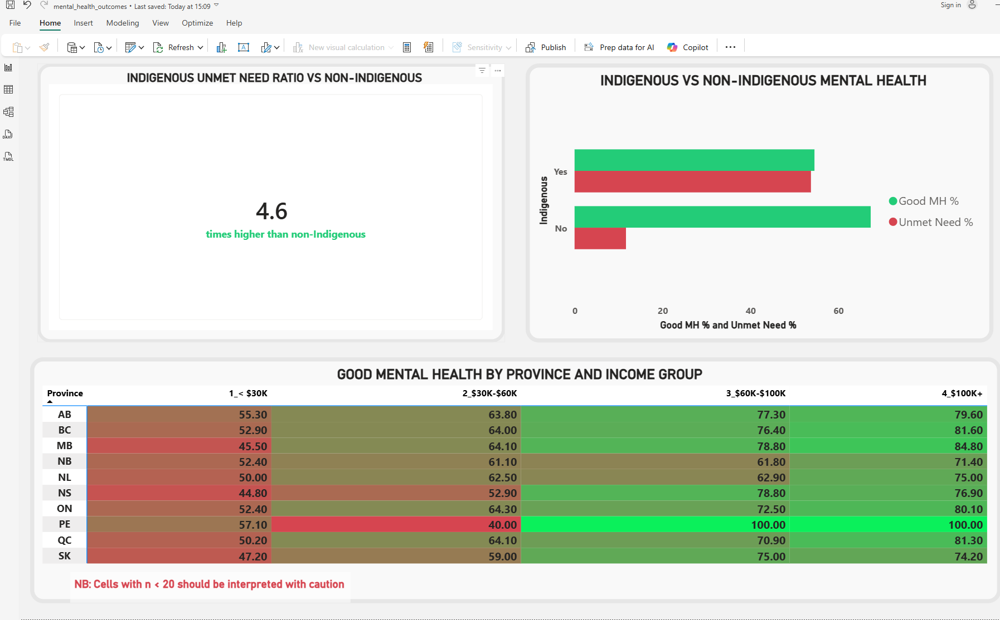

# Project 5: Provincial Mental Health Outcomes (CCHS PUMF)

> **DATA PROVENANCE:** This portfolio project uses simulated records informed by named Canadian public sources. All generated statistics, rankings, demographic differences, and savings models are illustrative rather than verified official estimates. Recommendations are hypothetical scenarios, not observed effects.

**Domain:** Mental Health / Population Health
**Tools:** Python · SQL · Power BI
**Public reference source (distinct from simulated analysis data):** Statistics Canada — CCHS Public Use Microdata File
**Download:** https://www150.statcan.gc.ca/n1/en/catalogue/82M0013X
(Free — registration and user agreement required)

---

## Business Question
What is the prevalence of mental health conditions across provinces and demographic groups, what predicts perceived mental health status, and where should provincial mental health investment be directed?

---

## How to Get the Real CCHS Data
1. Go to: https://www150.statcan.gc.ca/n1/en/catalogue/82M0013X
2. Create a free Statistics Canada account
3. Accept the user agreement
4. Download the PUMF CSV (CCHS_PUMF_Annual_Component.csv)
5. Download the data dictionary (codebook) alongside it
6. Rename: `cchs_pumf.csv` and place in this folder
7. Check the codebook to confirm variable names match constants in `simulate_cchs.py`

## How to Run (demo mode)
```bash
pip install pandas numpy
python simulate_cchs.py   # creates cchs_data.csv (~5,000 representative records)
python analysis.py        # full analysis — cleaning, prevalence, equity gaps, recommendations
```

---

## Analyst Roles

| Hat | What I Did |
|-----|-----------|
| Data Detective | Decoded CCHS coded variables (e.g., income quintile, valid skip codes), recoded Likert scales, handled "not stated" response codes, validated provincial sample sizes |
| SQL/Python Programmer | Calculated prevalence rates by province, age, sex, income, and Indigenous identity; cross-tabulated risk factor combinations; identified highest-need subgroups |
| Dashboard Architect | Built Power BI dashboard with provincial map, demographic breakdowns, condition prevalence, and unmet need analysis |
| Data Storyteller | Produced a plain-language mental health equity brief for a provincial mental health director |
| Strategic Consultant | Identified three underserved groups for targeted provincial investment with specific program recommendations |

---

## Illustrative analytical outputs

This project's Python/SQL outputs illustrate data processing, comparisons, modeling and reporting using generated records. The specific rates, rankings, cost figures and trends in the demonstration are **not verified official findings**. See the analysis scripts for the computations and the data limitations section below for interpretation requirements.

## Live Dashboard

Power BI report saved as a PBIX file; use Power BI Desktop to inspect it.

**Download:** `mental_health_outcomes.pbix` from this repo and open in Power BI Desktop to interact with the full report.

**Dashboard pages:**
- Page 1 — National Snapshot: KPI cards, condition prevalence bar chart, unmet need gauge
- Page 2 — Provincial Analysis: filled map, province ranking, Atlantic focus
- Page 3 — Demographic Breakdown: income gradient, age group, sex comparison
- Page 4 — Equity Analysis: Indigenous gap, high-risk group, income × province matrix

See `dashboard.md` for DAX measures and page-by-page build guide.

---

## Interpretation and real-world next steps

Use the simulated findings to demonstrate analytical methods, not to rank actual jurisdictions or recommend clinical or policy interventions. A real decision requires matched official data, documented definitions, relevant uncertainty, and clinical or operational stakeholder review. Financial scenarios must include assumptions, costs and sensitivity analysis.

## Files

| File | Purpose |
|------|---------|
| `simulate_cchs.py` | Builds representative respondent-level data from published CCHS statistics — income-based probability model anchored to CCHS income quintile tables and First Nations supplement |
| `analysis.py` | National snapshot, province ranking, demographic breakdown, Indigenous gap, condition prevalence, high-risk group analysis, recommendations |
| `sql_queries.sql` | 8 SQL queries covering prevalence, province ranking, demographic breakdowns, Indigenous gap, and equity analysis |
| `mental_health_outcomes.pbix` | Power BI dashboard — download and open in Power BI Desktop |
| `dashboard.md` | Power BI build guide with DAX measures for all 4 dashboard pages |
| `equity_brief.md` | Plain-language mental health equity brief for a provincial director |

---

## Data Provenance and Limitations

The respondent records are simulated, not actual CCHS PUMF respondents. Provincial, income, and Indigenous identity comparisons are illustrative, not survey estimates. They must not be generalized without actual survey weights, variance calculations, and careful validation of geography and population coverage.

Statistics Canada CCHS PUMF microdata is available free with registration. Individual respondent data requires signing a user agreement. This project uses simulated data built with an income-based probability model anchored to published CCHS prevalence statistics. All source figures are documented inline in `simulate_cchs.py`.

---

## Dashboard Screenshots




